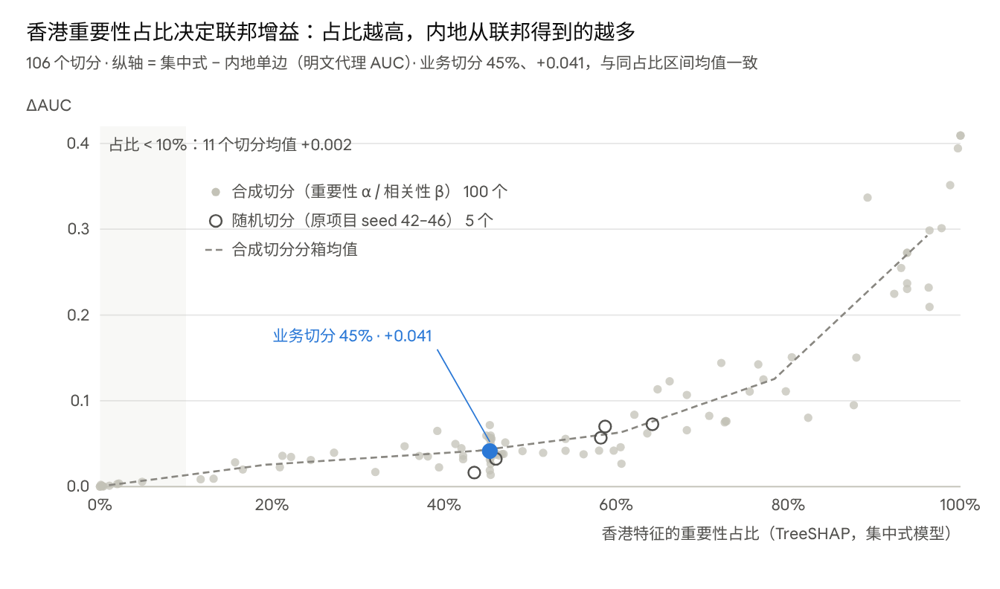

# 联邦 SGB 创新点说明：原理、实现路径与结果

> 2026-10-21 ｜ 外部实验记录（S9.E1）｜ 单 seed（42）+ 测试集客户级 bootstrap CI，不构成本仓库结论；适用边界见 [README](README.md)

## 概述

在隐语 SecretFlow 1.13 的 SGB 里，有 7 项创新可以直接落地。其中效率和精度类的 4 项只改参数、不改协议。合在一起，Santander 联邦 AUC 从 0.8991 升到 0.9091，与集中式等效。FedAds 训练从 77 分钟缩到 9 分钟，AUC 反而 +0.029。安全类给出两个可用的组合方案。另有两种攻击的复现，用来说明默认配置挡不住什么。

| # | 创新点 | 类型 | 在隐语中的落点 | 主要结果 | 建议 |
|---|---|---|---|---|---|
| 1 | OU 替换 Paillier | 效率 | HEU 加密方案参数 | 快 5.85 倍，预测逐位相同 | 默认开启 |
| 2 | 细分桶 + 三臂同等调参 | 精度 | 分桶粒度、树数 / 深度 / λ；明文代理选配置 | Santander +0.010，与集中式等效；HSBC mock +0.009 | 默认开启 |
| 3 | 先验初始分数 | 精度 | 初始分数 = 正例率的 logit，主动方本地计算 | FedAds +0.015；Santander 不变 | 默认开启 |
| 4 | 明文代理增益与切分预检 | 选型 | 明文 XGB 代替 SGB 估增益；VertiBench 切分扫描 | 实测与代理差 ≤ 0.003；香港占比 < 10% 时无增益 | 合作前必做 |
| 5 | A1 / A2 攻击复现 | 安全评估 | 按隐语源码重放协议消息 | 推理期香港已用列 100% 被还原；香港推断标签 AUC ≈ 0.88 | 用于风险评估 |
| 6 | 后验去噪标签 DP | 隐私 | 训练前对标签做随机响应，再用内地先验做后验去噪 | 同 ε 比硬标签高 +0.009 / +0.026 / +0.071 | 内地单边较强时启用（ε = 4） |
| 7 | SGB 训练 + SPU 安全推理 | 隐私 | 双方叶子可达矩阵在 SPU 内相乘 | AUC 不变，推理期 A2 消除；2.2 万客户 66–140 s | 优先评估 |

**推荐组合**：训练用 1 + 2 + 3，推理用 7，合作前用 4 做预检；内地单边较强时加 6。训练期的泄漏（A1、训练期 A2）这些方案都没有解决，需要 SS-XGB 或合规层面兜底。

## 实验底座与口径

所有结论都来自同一套流水线：隐语 SecretFlow 1.13.0b0 的 SGB（sgb_v），在 debug 单进程模式下模拟两方。耗时在 2 核容器里测得，只用于相对比较。

- **两方角色**：内地 = 主动方（持有标签、部分特征和私钥）；香港 = 协作方（只有特征，用公钥做同态计算）。
- **威胁模型**：两方半诚实、不合谋，只利用协议中合法收到的消息。
- **评估**：主指标 AUC；95% CI 用客户级配对 bootstrap（1000 次，seed 42），各方案在同一批重采样上比较。
- **公平对照**：内地单边、香港单边、集中式三臂在验证集上同等调参；测试集只评一次。否则会把「调参收益」误记成「联邦增益」。

| 数据集 | 规模与切分 | 正例率 | 测试口径 |
|---|---|---|---|
| Santander 产品推荐 | 训练 78,267 行 / 测试 21,735 行；内地 20 列（人口属性）、香港 25 列（产品持有） | 3.7% | 时间外推 |
| HSBC mock 四档 | Santander 变形版：balanced、重合率 80 / 50 / 20% | — | 时间外推 |
| FedAds（阿里妈妈） | 官方训练集抽 30 万、测试集抽 20 万；官方两方切分 | 0.6% | 官方测试集 |
| Orange KDD Cup 2009 | 5 万行、230 个匿名变量；流失 / 升级购买两个任务；变量随机对半 | 7.3% / 7.4% | 分层随机 20% |
| IEEE-CIS | 团队 vfl_official 的 PSI 交集（行数不在公开仓库披露）；内地 = 交易表、香港 = 身份表 | 7.85% | 时间顺序最后 20% |

## 创新点 1：OU 替换 Paillier

只换同态加密方案，训练快 5.85 倍，测试集 21,735 个预测值与 Paillier 版逐位相同。

**原理**：SGB 的密文开销集中在两处：内地加密每个样本的梯度 g、h，香港按桶做同态加法。OU（Okamoto–Uchiyama）和 Paillier 一样是加法同态方案，但密文在模 n 下，Paillier 在模 n² 下。同样 2048 位密钥时，OU 的密文短一半，加密和同态加法都更快。梯度的定点编码不变，解密后的桶和完全相同，所以整个训练过程和结果不变。

**实现路径**

- 隐语的 HEU 已内置 OU，不需要改协议：把 HEU 配置里的 schema 从 `paillier` 换成 `ou`，私钥仍由内地持有。
- 入口：`train_federated_sgb_opt.py --he-schema ou`（原 `train_federated_sgb.py` 的超集，不加参数时行为与原版一致）。

**结果**（Santander，同配置 100 棵树）

| 加密方案 | 训练耗时 | 测试 AUC |
|---|---|---|
| Paillier 2048 | 5,638 s | 0.8991 |
| OU 2048 | 963 s | 0.8991（预测值差为 0） |

**局限**：OU 的安全性依赖 n = p²q 的分解难题，和 Paillier 的假设不同；生产上线前应按机构密码合规要求确认密钥长度。

## 创新点 2：细分桶 + 三臂同等调参

把分桶从约 10 个细化到约 33 个，并用明文代理调好树数、深度和 λ。Santander 联邦 AUC 提高 +0.010，与集中式等效；两项缺一不可。

**原理**

- SGB 只加密梯度，分裂搜索与同分桶的明文直方图 GBDT 在数学上等价。所以联邦模型的上限就是同分桶、同超参的集中式模型。
- 原版有两处损失：隐语默认 sketch_eps = 0.1（约 10 个桶），分裂点太粗；经典默认超参（100 棵、深度 5、学习率 0.3、λ 0.1）不适合小样本和不平衡数据。
- 三臂必须同等调：只调联邦而让单边用默认参数，会把调参收益误记成联邦增益。

**实现路径**

1. `make_val_tag.py`：从训练窗口切出验证集（Santander 为窗口末 3 个月），测试集在终评前不碰。
2. `tune_proxy.py`：在验证集上对三臂各自搜 48 组配置（学习率 × 深度 × λ × 列采样），早停 20 轮定轮数。
3. 选择规则：验证 AUC 距最优不超过 0.001 的配置中，取「轮数 × 深度」最小者，因为 SGB 的密文计算量与它成正比。
4. 联邦用集中式臂选出的配置，再加 `--sketch-eps 0.03`；`final_eval.py` 在测试集上只评一次。

**结果一：Santander 分解**（均为 OU）

| 配置 | 测试 AUC | 相对原版 [95% CI] | 相对集中式 [95% CI] | 训练耗时 |
|---|---|---|---|---|
| 原版参数（100 棵 / 深度 5 / λ 0.1 / 约 10 桶） | 0.8991 | — | −0.0118 [−0.0173, −0.0063] | 963 s |
| 只细分桶 | 0.9008 | +0.0017 [−0.0033, +0.0065] | −0.0101 [−0.0145, −0.0057] | 2,116 s |
| 只调参（134 棵 / 深度 6 / λ 10） | 0.9048 | +0.0057 [+0.0020, +0.0097] | −0.0060 [−0.0106, −0.0018] | 2,312 s |
| 优化版（调参 + 细分桶） | 0.9091 | +0.0100 [+0.0051, +0.0150] | −0.0017 [−0.0048, +0.0015] | 3,604 s |

**结果二：其他数据集**（优化版 vs 原版默认）

| 数据集 | 原版联邦 | 优化版联邦 | 差 [95% CI] | 训练耗时 |
|---|---|---|---|---|
| HSBC mock balanced | 0.8947 | 0.9038 | +0.0092 [+0.0040, +0.0142] | — |
| FedAds（含创新点 3） | 0.6210 | 0.6502 | +0.0292 [+0.0160, +0.0427] | 77 → 9 分钟 |
| Orange 流失（含创新点 3） | 0.6997 | 0.7322 | +0.0325 [+0.0205, +0.0457] | 75 → 24 分钟 |
| Orange 升级购买（含创新点 3） | 0.8333 | 0.8683 | +0.0350 [+0.0241, +0.0458] | 43 → 21 分钟 |

这四组对比中，优化版与集中式之差的 CI 都含 0。原版默认参数在 FedAds 和 Orange 两个任务上甚至低于内地单边（内地单边分别为 0.6289、0.7185、0.8640），也就是说没有联邦增益。

**局限**：在 Santander 上，优化版树更多、更深，耗时是原版参数的 3.7 倍；但加上创新点 1 后，仍比原版 Paillier（5,638 s）快。分桶再细（约 125 桶）时每轮 45 s；sketch_eps 低于 0.005 时隐语 1.13 会报错。

## 创新点 3：先验初始分数

把初始分数从 0 改为正例率的 logit，FedAds 提高 +0.015；在正例不太少、树较多的 Santander 上无影响。

**原理**：隐语 SGB 的 base_score 默认为 0，也就是每个样本从预测概率 0.5 开始拟合。正例只有 0.6% 时，前几棵树主要在把整体分数从 50% 压到 0.6%，20 棵树里浪费了一大半。改用训练标签均值 p 的 logit 作初始分数，树从第一棵起就在学排序。

```math
\text{base\_score} = \operatorname{clip}\left(\ln\frac{p}{1-p},\ -10,\ 10\right),\qquad p = \frac{1}{n}\sum_{i=1}^{n} y_i
```

这个量只用内地本地的标签统计，香港本来就看不到分数，不增加任何泄漏。

**实现路径**：`train_federated_sgb_opt.py --base-score prior`，在主动方算出 logit 后写入 SGB 参数 `base_score`；也可以直接传数值。FedAds 为 −5.12，IEEE-CIS 为 −2.51。

**结果**

| 数据集 | 正例率 / 树数 | 初始分数 0 | 先验初始分数 | 差 [95% CI] |
|---|---|---|---|---|
| FedAds | 0.6% / 20 棵 | 0.6351 | 0.6502 | +0.0150 [+0.0066, +0.0240] |
| FedAds 明文复验（同配置 XGB） | 0.6% / 20 棵 | 0.6388（初始 0.5） | 0.6515 | +0.0127 |
| Santander | 3.7% / 134 棵 | 0.9091 | 0.9086 | −0.0005 [−0.0029, +0.0021] |

**结论与局限**：正例极少、树很少时收益大；其余情况下，初始分数的偏差很快被后续树吸收，无害也无益。建议默认开启。

## 创新点 4：明文代理增益与切分预检（VertiBench 式）

联邦增益可以用明文代理在秒级估出，与 SGB 实测的差不超过 0.003。增益主要由香港特征的重要性占比决定，占比低于 10% 时几乎为 0。

**原理**

- 由创新点 2 的等价性，代理增益 Ĝ = AUC(集中式) − AUC(内地单边)，用明文 XGB 几秒就能算出，而一次 SGB 要几十分钟到几小时。
- VertiBench（Wu 等，ICLR 2024）用两个旋钮生成可控的纵向切分。重要性切分 α：两方占比 r ~ Dir(α, α)，每列按 r 随机归属，α 越小越失衡。相关性切分 β：用下式度量跨方相关，β = 0 表示方内强相关、跨方弱相关。

```math
\mathrm{Pcor}(X_i,X_j)=\frac{1}{\sqrt{d}}\,\operatorname{std}\big(\sigma_1(C_{ij}),\dots,\sigma_d(C_{ij})\big),\qquad C_{ij}=\mathrm{Spearman}(X_i,X_j),\ d=\min(m_i,m_j)
\\[6pt]
\mathrm{Icor}=\mathrm{Pcor}(X_g,X_h)-\tfrac12\big[\mathrm{Pcor}(X_g,X_g)+\mathrm{Pcor}(X_h,X_h)\big],\qquad \mathrm{Icor}^{*}(\beta)=(1-\beta)\,\mathrm{Icor}_{\min}+\beta\,\mathrm{Icor}_{\max}
```

**实现路径**

1. `gain_proxy.py`：任意切分的代理增益及配对 CI。
2. `vertibench_scan.py`：用集中式模型的 TreeSHAP 均值 |φ| 算各列重要性；按 Dirichlet 生成 α 切分；用 BRKGA（偏向随机键遗传算法）求 Icor 的极值和目标 β 切分；另加一组「控占比」切分，把香港占比钉在 45% 只动 β。客户级 bootstrap 做了向量化，与显式重采样逐位一致。
3. `make_split_tag.py` + `vertibench_confirm.py`：把选中的切分落成数据，跑优化版 SGB 和攻击做复核。



数据：`results/vertibench_scan.json`（Santander 业务 tag 45 列，106 个切分）

**结果**

1. 106 个切分里，香港占比与增益的秩相关为 +0.89。占比低于 10% 的 11 个切分里只有 4 个增益 CI 不含 0；30–50% 区间的 38 个增益 CI 全部不含 0。
2. 把占比钉在 45% 时，跨方高度冗余（β = 1）的增益为 +0.029，β ≤ 0.75 的四档为 +0.044 到 +0.054。
3. 业务切分不是挑出来的：它的增益和同占比区间的均值一致，略高于同占比的随机切分，因为它的跨方相关更低（β̂ = 0.17）。
4. 外部数据集印证：Orange 升级购买任务里香港占比 22%，但 β̂ = 0.96，增益为 0；IEEE-CIS 在 AUC 0.93 的树模型下增益仍为 +0.0039，与团队 LR 的 +0.0038 一致。

| 切分（SGB 复核） | 香港占比 | 代理 Ĝ | SGB 实测：联邦 − 内地 [95% CI] |
|---|---|---|---|
| 低占比 | 12% | +0.0086 | +0.0074 [+0.0028, +0.0118] |
| 业务切分 | 45% | +0.0414 | +0.0386 [+0.0302, +0.0478] |
| 高占比 | 93% | +0.2548 | +0.2520 [+0.2291, +0.2746] |

**用途**：选合作方时看对方特征的重要性占比和互补性，而不是列数；全量联邦前先用代理或少量树预检。**局限**：TreeSHAP 占比需要集中式模型，实际合作前拿不到；可用 SGB 少量树里双方分裂增益之和代替（尚未验证）。

## 创新点 5：攻击复现（A1 标签推断、A2 特征还原）

按隐语源码重放协议消息后，两类半诚实攻击在所有数据集上都成立。推理期，内地能 100% 确定还原模型用到的香港离散列（Santander、FedAds）。香港借叶子划分，在已知 5% 标签时把内地标签推断到 AUC 0.88（Santander）。

**原理：泄漏从哪里来**（隐语 1.13 sgb_v）

- 每层分裂后，样本到子节点的选择向量会发给所有参与方，用来算下一层的桶和。所以香港知道每棵树的叶子成员。
- 分裂落在香港特征上时，香港把左右划分回传给内地。隐语只在同一特征内打乱桶的顺序，不打乱特征本身，所以内地能认出是哪一列。

**攻击做法**

- **A1（香港推断内地标签）**：香港把自有特征和叶子成员 one-hot 拼起来，用已知的 1% 或 5% 标签训练逻辑回归，推断其余样本。泄漏 = 推断 AUC − 只用自有特征的 AUC。
- **A2（内地还原香港特征）**：内地为每个「样本 × 香港特征」维护一个取值区间，每经过一个香港节点就收紧一次；区间内只剩一个可能取值就计为「确定还原」。训练期用完整路由，推理期用香港视角的可达集。

**实现路径**

1. `train_federated_sgb_opt.py --dump-model`：导出树结构、分裂归属和叶子权重。
2. `sgb_replay.py`：按隐语源码重放路由和预测，重放预测与隐语输出的最大偏差为 3.5e-7，确认重放即协议真实消息。
3. `attacks.py --known-frac 0.01 0.05`：输出 A1、A2（训练期、推理期）的结果，以及不知道列名时的匹配结果。

**结果**（A1 取已知 5% 标签）

| 数据集 / 配置 | A1：香港推断标签 AUC（自有 → 加叶子） | A1 泄漏 | A2：推理期已用香港列被确定还原 |
|---|---|---|---|
| Santander 原版 | 0.787 → 0.855 | +0.069 | 24 / 25 列，100% |
| Santander 优化版 | 0.787 → 0.884 | +0.097 | 22 / 25 列，100% |
| Santander 低占比切分（12%） | 0.614 → 0.883 | +0.269 | 20 / 25 列，84% |
| FedAds 原版 | 0.539 → 0.673 | +0.133 | 23 / 23 列，100% |
| FedAds 优化版 | 0.539 → 0.631 | +0.090 | 9 / 23 列，100% |
| Orange 流失 优化版 | 0.565 → 0.702 | +0.137 | 33 / 67 列，27% |
| Orange 升级购买 优化版 | 0.551 → 0.874 | +0.323 | 44 / 67 列，35% |

1. **泄漏随模型暴露的节点数变化**：FedAds 优化版树少、树浅，效果更好、泄漏也更少；Santander 优化版树更多更深，泄漏更大。
2. **叶子能泄漏多少，取决于模型本身的能力**，与香港贡献多少无关。香港自有特征越弱，净泄漏越大。
3. **A2 对离散特征最有效**（产品持有标记、one-hot）；连续特征只能还原到区间，确定还原的比例低（Orange 27%）。

Orange 的自有特征量纲差异大，「自有 + 叶子」的逻辑回归反而不如「只用叶子」，表中取两者中较好的一个。

## 创新点 6：后验去噪标签 DP

在同一隐私预算 ε、同等泄漏下，把加噪后的硬标签换成后验软标签，Santander 联邦 AUC 提高 +0.009 / +0.026 / +0.071（ε = 4 / 2 / 1）。ε = 4 时仍比内地单边高 +0.025。

**原理**

- 标签随机响应（RR）：每个标签以概率 ρ = 1/(1+e^ε) 翻转，满足 ε-标签差分隐私。但直接用翻转后的标签训练损失很大：ε = 2 时联邦增益变为 −0.027。
- 差分隐私对后处理封闭：只用加噪标签和内地自有特征做的任何计算，都不增加隐私损失。
- 利用这一点，内地先用自有特征和加噪标签训练一个先验模型，去掉 RR 带来的偏差得到 p(x)。再按贝叶斯公式把每个加噪标签 ỹ 换成后验概率，作为软标签送入 SGB。

```math
p(x)=\operatorname{clip}\!\left(\frac{q(x)-\rho}{1-2\rho}\right),\qquad \rho=\frac{1}{1+e^{\varepsilon}}
\\[6pt]
P(y=1\mid \tilde y=1,x)=\frac{p(x)(1-\rho)}{p(x)(1-\rho)+(1-p(x))\rho},\qquad P(y=1\mid \tilde y=0,x)=\frac{p(x)\rho}{p(x)\rho+(1-p(x))(1-\rho)}
```

其中 q(x) 是用加噪标签训练的模型输出。SGB 使用 logistic 损失，可以直接接受 [0, 1] 内的软标签。

**实现路径**

1. `train_federated_sgb_opt.py --label-rr-eps ε --label-dp rr_soft`：在标签进入隐语之前完成加噪和去噪，隐语协议不动。
2. 先验模型：HistGB（100 轮、深度 5），2 折交叉拟合，避免样本用到自己的加噪标签。
3. `label_dp_proxy.py`：先在明文代理上筛选变体（对称 RR、后验去噪、RRWithPrior 及其软标签版），再跑联邦。

**结果**（Santander，原版配置 100 棵；内地单边 0.8667）

| ε（翻转概率） | 硬标签 RR | 后验软标签 | 软 − 硬 [95% CI] | 软标签相对内地单边 | A1 泄漏（硬 / 软） |
|---|---|---|---|---|---|
| 4（1.8%） | 0.8828 | 0.8916 | +0.0088 [+0.0000, +0.0169] | +0.025 | +0.055 / +0.061 |
| 2（11.9%） | 0.8393 | 0.8657 | +0.0264 [+0.0118, +0.0412] | −0.001 | +0.036 / +0.034 |
| 1（26.9%） | 0.7473 | 0.8182 | +0.0709 [+0.0442, +0.0982] | −0.049 | +0.024 / +0.023 |

无防护时 A1 泄漏为 +0.069。软标签只提高了效用，泄漏与硬标签基本相同。

**局限**：效果取决于内地自有特征能否给出有效先验。FedAds 内地单边只有约 0.63，后验去噪无效。另外，标签 DP 只限制标签泄漏，叶子划分仍然会反映模型学到的排序。

## 创新点 7：SGB 训练 + SPU 安全推理

训练仍用 SGB，推理改在 SPU 里做。AUC 与原生推理一致，内地在推理期不再看到香港节点的走向，推理期 A2 攻击消失。

**原理**

- 原生推理时，香港把自己节点上的左右判断交给内地。内地每打一次分，就能得到一批「香港特征在哪个区间」的信息。
- 改法：每方只用自己的分裂节点，算出每个样本「可能到达哪些叶子」的 0/1 矩阵（对方的节点视为两边都可达）。两方矩阵逐元素相乘，恰好是真实到达的叶子。
- 把两个矩阵秘密共享进 SPU（SEMI2K 协议），在密文中相乘、乘以叶子权重并求和，只把最终分数揭示给内地。

```math
\text{score}(x)=\text{base}+\sum_{t=1}^{T}\big(S^{(t)}_{\text{label}}(x)\odot S^{(t)}_{\text{host}}(x)\big)\,w^{(t)}
```

**实现路径**

1. `secure_infer.py`：用 `leaf_select` 为每方构造叶子可达矩阵（样本数 × 叶子数）。
2. 在 SPU 中计算 `(a * b) @ w`，按树分批累加，最后 `reveal` 到内地并加上初始分数。
3. 工程要点：`sf.init` 的 num_cpus 必须大于 2，否则两个 SPU actor 占满资源导致死锁；64 个叶子的模型每批不超过 3 棵树（`--batch-trees 3`），否则内存不足。

**结果**

| 模型 | 树数 | 打分样本 | SPU 推理耗时 | AUC（安全 / 原生） | 逐样本最大偏差 |
|---|---|---|---|---|---|
| Santander 原版 | 100 | 21,735 | 66.3 s | 0.8991 / 0.8991 | 1.7e-5 |
| Santander 优化版 | 134 | 21,735 | 140.3 s | 0.9091 / 0.9091 | 2.6e-5 |
| FedAds 优化版 | 20 | 200,000 | 53.6 s | 0.6502 / 0.6502 | 1.6e-6 |

**局限**：只保护推理期，训练期的 A1 和 A2 不变；叶子权重仍以明文留在内地（内地本来就是模型持有方）。耗时随「样本数 × 叶子数」增长，大批量打分需要分批。

## 对照：试过但不采用、或隐语已内置的方法

下列方法都做了复现或源码核对，结论是不采用、无需再做，或只作备选。

| 方法 | 来源 | 结果 | 结论 |
|---|---|---|---|
| GOSS 梯度单边采样 | LightGBM；隐语开关 | 验证集 0.9003 → 0.8011（λ 0.1）/ 0.8724（λ 10），叶子权重溢出 | 不采用 |
| 梯度定点量化 | 隐语开关 | 验证集 0.8993（基线 0.9003），每轮 9.2 s vs 10.5 s | 可选，收益在噪声内 |
| 直方图相减、GH 打包 | SecureBoost+ | 隐语 1.13 已内置：每层只算样本较少的子节点，另一个用父节点相减；g、h 默认打包进一个明文 | 无需再做 |
| 密文压缩 | SecureBoost+ | 隐语未实现，需要改 HEU | 未做 |
| packbits | 隐语开关 | 只压缩样本选择向量的传输，单进程模拟测不出收益 | 多机部署时再测 |
| 首树只用主动方特征 / 混合树 | 隐语默认 / SecureBoost+ | 关掉首树保护后 A1 泄漏不变（+0.069）；可见树从 99 棵减到 10 棵，泄漏仍有 +0.075，只留 1 棵时为 +0.051 | 防不住 A1 |
| 香港特征随机响应（ε = 2） | 本地差分隐私 | 联邦 0.8646，低于内地单边 0.8667（无防护时增益 +0.032） | 增益归零 |
| 香港数据最小化（24 个产品标记 → 持有数） | 数据最小化 | 联邦 0.8707，增益只剩 +0.004 | 增益归零 |
| RRWithPrior | Ghazi 等 NeurIPS 2021 | 明文代理：ε = 4 时 0.8926（略高于对称 RR 0.8857），ε = 2 / 1 时 0.7543 / 0.6493，远低于对称 RR 的 0.8399 / 0.7533 | 不平衡标签上不采用 |
| SS-XGB（秘密共享训练） | Fang 等 CIKM 2021；隐语 SPU | 全量每棵树 104.6 s，约为 SGB+OU 的 11 倍，100 棵约 2.9 小时 | 训练期高安全场景备选 |
| 主动方列数成本 | 本项目发现 | 主动方自己的桶和也走 HEU 大整数路径；IEEE-CIS 内地 360 列时每棵树约 290 s，Santander 20 列约 32 s | 内地本地特征筛选待验证 |

## 代码与复现

全部代码都在团队仓库 `federated_learning_new` 原版流水线之上新增，放在 `src/ext/`，原仓库文件一行未改。打包目录为 `secretflow_sgb_innovations/`，内含代码、实验队列脚本、结果 JSON 和汇总 xlsx；原始数据和派生数据不入库。

- **本机副本**：`8-9月/federated_learning_new_复现与优化/secretflow_sgb_innovations/`。
- **GitHub**：计划推到 `conceal008/HSBC-VFL-personal-project` 的同名目录，等 GitHub 账号关联后推送。

| 创新点 | 文件 | 关键参数 |
|---|---|---|
| 1 OU | `train_federated_sgb_opt.py` | `--he-schema ou` |
| 2 细分桶 + 调参 | `make_val_tag.py`、`tune_proxy.py`、`final_eval.py` | `--sketch-eps 0.03`、`--num-boost-round`、`--max-depth`、`--reg-lambda` |
| 3 先验初始分数 | `train_federated_sgb_opt.py` | `--base-score prior` |
| 4 代理与切分预检 | `gain_proxy.py`、`vertibench_scan.py`、`vertibench_summary.py`、`make_split_tag.py`、`vertibench_confirm.py` | `--alphas`、`--betas`、`--fix-share` |
| 5 攻击复现 | `sgb_replay.py`、`attacks.py` | `--dump-model`、`--known-frac 0.01 0.05` |
| 6 后验去噪标签 DP | `train_federated_sgb_opt.py`、`label_dp_proxy.py` | `--label-rr-eps`、`--label-dp rr_soft` |
| 7 SPU 安全推理 | `secure_infer.py` | `--batch-trees 3` |

**复现顺序**

1. 按原仓库 README 准备 Santander 数据，把 `src/ext/` 放进原仓库。
2. 用 `make_val_tag.py` 切验证集，用 `tune_proxy.py` 对三臂调参。
3. 分别跑原版和优化版 SGB（加 `--dump-model`），再用 `final_eval.py` 在测试集上评一次。
4. 对导出的模型跑 `attacks.py`；跑标签 DP 和 SPU 安全推理。
5. 其他数据集先用对应的 `make_*_tags.py` 生成数据，再重复第 2–4 步。

**局限**

- 耗时在 2 核容器、隐语 debug 单进程模式下测得，没有网络开销，只用于相对比较。
- 每个方案只跑了一个种子（seed 42），不确定性来自测试集的客户级 bootstrap，不含训练随机性。
- IEEE-CIS 的 SGB 实跑还没跑完：内地 360 列时每棵树约 290 s，需要先做主动方本地特征筛选。目前只有明文三臂结果。
- SS-XGB 只测了成本（前几棵树），没有跑满 100 棵。
