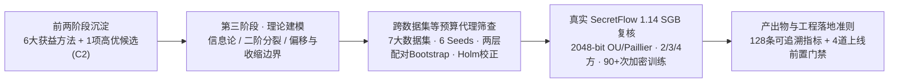
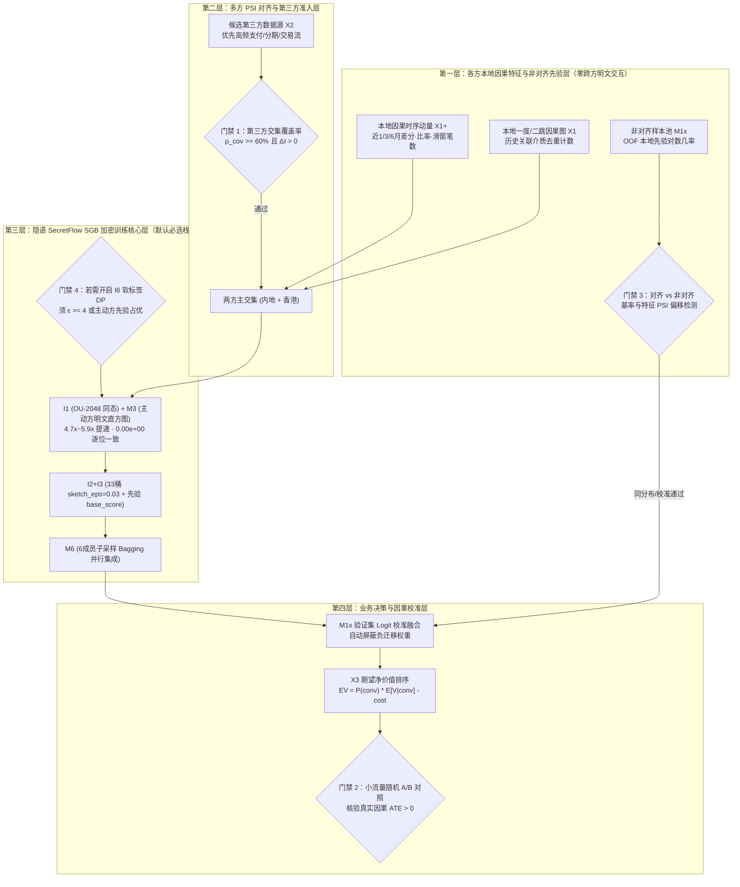

# 汇丰纵向联邦学习课题 · 第三阶段成果汇报报告
## —— 跨领域创新方法的理论机制、跨数据集泛化实证与真实隐语 SGB 边界核定

> 编写日期：2026-11-20 ｜ 版本：v1.0 ｜ 状态：定稿（面向项目组第三阶段成果汇报）
> 数据来源：[stage3_master_summary.csv](../../../modules/m5_modeling/results/stage3_cross_dataset_v1/stage3_master_summary.csv)（第三阶段 9 组实验 JSON 共 128 条冻结指标）、第二阶段对照基准（`优化方法与数据集_增益与组合报告_v1.7/v1.8`，见 `m5/method-screen-3` 分支）与本地图特征初步实验报告 v0.4
> 口径基准：2026-07-29 会议纪要（聚焦线性模型与树模型/SecretFlow SGB；排除 FATE 与神经网络；UCI 严格剔除未来信息字段 `duration`）

---

## 1. 汇报主线：第三阶段解决了什么核心问题？

在第一阶段（工程原型验证）与第二阶段（单一主数据集上的 17 种候选方法初筛）之后，课题在迈向「跨境共同客户联合营销与风险评估」落地前，面临**三个必须回答的科学问题**：

1. **跨数据集泛化性（Generalizability）**：前期在单一数据集上拿到显著增益的创新方法（`X2` 第三方扩展、`X1/X1+` 图与时序速度、`M1x` 非对齐样本利用、`X3` 期望价值排序、`I1/M3/I2+I3/M6/I6` 协议与隐私优化），换到**全新的金融/营销数据表、滚动时间窗和不同行业分布**下，还能获得多少增益？
2. **真实加密协议一致性（Protocol Fidelity）**：明文直方图梯度提升（HistGBDT / XGBoost）代理上测出的增益，在**真实隐语 SecretFlow 1.14.0b0 SGB（2048-bit PHEU 同态加密、33 分位数桶、浅树受限预算）**下是否真正成立？耗时代价是多少？
3. **理论机制与失效边界（Theory & Failure Boundaries）**：为什么同一个方法在 A 场景大涨、在 B 场景持平甚至负迁移？其背后的**信息论、二阶泰勒逼近、分布偏移与贝叶斯收缩机理**是什么？上线前用什么定量门禁（Gatekeeper）提前判定“该不该开”？

> [!IMPORTANT]
> **第三阶段核心成果一句话总结**：
> 完成了 **7 个公开数据集、9 组冻结实验（128 条指标）、90+ 次真实 SecretFlow 1.14.0b0 SGB 同态加密训练** 的交叉验证；不仅证明了 **`I1+M3`（4.7×–5.9× 提速，逐位零误差）、`I2+I3+M6`（真 SGB 4/4 数据集全正向 `+0.29pp`–`+1.83pp`）、`X2` 高频履约第三方（真 SGB `+1.79pp`–`+2.85pp`）、`X1+` 本地因果时序速度（真 SGB `+1.01pp`–`+3.91pp`）** 的跨场景普适增益，更通过理论推导与正反实验**首次钉死了 `M1x`（同分布 `+1.48pp` vs 跨渠道偏移 `-0.54pp`）、`I6`（主动方强/高 $\varepsilon$ `+0.76pp` vs 被动方强/低 $\varepsilon$ `-6.66pp`）、`X3`（捕获价值 vs 随机 A/B 因果增量）的数学边界，并系统证伪了纯主动方表格型 `C2` Lookalike（5/5 未显著，最高劣化 `-0.61pp`）**。

---

## 2. 第三阶段全局成果总表（理论机制 × 跨数据集实证 × 真实 SGB 复核）

下表汇总第三阶段全部 8 项被测方法的理论根基、新增验证数据集、精确增益区间及最终分级判定（全部原始数据可溯源至 [stage3_master_summary.csv](../../../modules/m5_modeling/results/stage3_cross_dataset_v1/stage3_master_summary.csv)）：

| 梯队 | 方法代号与名称 | 核心理论机制 | 第三阶段新验证数据集 | 6-seed 等调参代理增益（95% CI，`p_holm`） | 真实 SecretFlow 1.14 SGB 复核（2048-bit HEU） | 落地判定与前置门禁 |
|---|---|---|---|---|---|---|
| **T1 默认必选** | **I1 (OU 同态) + M3 (主动方明文直方图)** | $\mathbb{Z}_{n^2}^*$ ($n=p^2q$) 同态加法降阶 + 主动方（sk_keeper）本地分裂免密文累加等价定理 | COIL2000、UCI Bank（去 `duration`）、Hillstrom、Home Credit（4 方） | —（直接跑真 SGB） | **3/3 跨数据集提速 4.74×–5.93×**（OU 3.62×–3.88×，M3 再快 1.31×–1.54×）；**4 方 M3 提速 1.66×**；全部 `max_abs_diff = 0.00e+00` | **无条件开启**：零精度损失、被动方密文视图完全不变 |
| **T1 默认必选** | **I2+I3 (33 桶 + 先验基分 + 调参) + M6 (6 成员 Bagging)** | 二阶泰勒首轮曲率校准 $h_0=\bar{y}(1-\bar{y})$ + 分位数逼近误差 $\mathcal{O}(\varepsilon_{\text{sketch}}^2)$ + 集成方差缩减 $\frac{1-\rho}{M}\sigma^2$ | COIL2000、UCI Bank、Hillstrom、Home Credit 8k | 各数据集代理 Bagging6 均稳定高于单模型均值 `+0.15pp`–`+0.51pp` | **4/4 真 SGB 全正向**：`I2+I3` 增益 **`+0.23pp` 至 `+1.46pp`**；叠加 `M6` 再增 **`+0.05pp` 至 `+0.37pp`**（Home Credit 合计 **`+1.83pp`**，COIL2000 合计 **`+1.60pp`**） | **无条件开启**：`I2+I3` 零额外耗时；`M6` 耗时 6×（支持多进程并行） |
| **T2 主力涨点** | **X2 多方/高频第三方参与方扩展** | 条件互信息增益 $\Delta I(Y; X_C \mid X_A, X_B)$ 与异构特征正交性；部分覆盖率 $\rho_{\text{cov}}$ 线性衰减律 | Home Credit **全新支付履约 4 表**（3 方 & 4 方）；Santander【构造三方】；UCI【构造三方】 | HC 新支付三方 **`+2.18pp`**（`[+1.59, +2.72]pp`，`p=0.016`，为静态 `bureau +0.39pp` 的 **5.6 倍**）；四方 **`+2.45pp`**；Santander **`+0.80pp`**（`p=0.008`）；UCI **`+2.94pp`**（`p=0.006`） | HC 新三方 **`+1.79pp`**（`p=0.004`）、四方 **`+1.84pp`**（`p=0.004`）；UCI 三方 **`+2.85pp`**（`p=0.002`）；Santander 10k 切片 `+0.18pp`（同向未显著） | **强烈推荐**：优先接入高频交易/履约第三方；**门禁 1**：PSI 重合覆盖率 $\rho_{\text{cov}} \ge 60\%$（70% 覆盖仍 `+1.42pp`，40% 降至 `+0.36pp` ns） |
| **T2 主力涨点** | **X1 / X1+ 本地因果图与时序速度** | 局部因果马尔可夫状态转移算子 $\Phi_{\text{causal}}(x_{\le t})$ 注入关系与一阶导数归纳偏置；受限树预算下的特征蒸馏效应 | Santander 7 月因果动量；Home Credit 历史申贷/还款速度；IEEE-CIS 3 滚动窗 | Santander 2 方 **`+3.87pp`**（PR 翻倍 `0.213→0.428`）、3 方 **`+4.04pp`**（`p=0.010`）；HC 2 方上 **`+1.44pp`**（`p=0.008`），3 方静态全表上 `-0.14pp`（ns）；IEEE 全 400+ 列代理 3 窗未显著 | Santander **`+3.91pp`**（`p=0.002`，PR `0.190→0.362`）；**IEEE W3 紧致 60 列真 SGB `+1.01pp`**（`p=0.002`，耗时反降 **23%**）；HC 3 方静态上 `+0.48pp`（`p=0.124`） | **强烈推荐（时序/交易流场景）**：零跨方明文交换；当静态聚合已充分刻画长期违约水平时无需重复叠加 |
| **T2 决策增效** | **X3 价值 − 风险期望净值排序** | 异质客单下预算受限背包最优准则 $\text{EV}_i = p_i \hat{V}_i - c$；Rubin 潜在结果框架下捕获价值与因果 ATE 分解 | Santander（真实 `renta` 加权【假设】）；COIL2000（购买力加权【假设】）；Hillstrom（真实美元 `spend` + 随机 A/B） | Santander Top20% **`+3,744.5 EUR`**（捕获占比 `77.5%→81.7%`，`p=0.018`）；COIL2000 Top5% `+1,515.0 EUR`（`+17.8%` 净利，CI 不跨零，`p_holm=0.096`）；Hillstrom 三档全正向（`+231/+93/+71 USD`）但 116 正例下未达显著 | 决策层后处理，直接作用于 SGB 概率输出，零加密开销 | **推荐用于高客单差异场景**；**门禁 2**：上线须配小流量随机对照组核验因果增量（防止只抓 Sure Things） |
| **T3 条件启用** | **M1x 非对齐样本本地先验 + 校准融合** | 半监督边缘风险方差缩减 $\mathcal{O}(|D_A|^{-1/2})$ vs 跨渠道分布偏移 $D_{\text{KL}}(P_{\text{un}}\,\|\,P_{\text{al}})$ 与验证集 Logit 仿射校准 | Home Credit 20%/50%【构造低重合】（同分布）；IEEE-CIS 44.6 万真实非对齐（3.75× 欺诈率偏移） | HC 同分布 20% 重合 `M1x_logit` **`+0.41pp`**（`p=0.008`）、50% 重合 **`+0.21pp`**（`p=0.008`）；IEEE 异质非对齐下直接注入先验特征**负迁移 `-0.59pp`**，`M1x_logit` 稳健保底（`+0.05pp`） | **HC 20% 重合真 SGB `+1.48pp`**（`[+0.48, +2.59]pp`，`p=0.004`，额外耗时仅 **+0.3s**）；IEEE 异质真 SGB `-0.54pp`（`p=0.166`，复现负迁移） | **条件启用**；**门禁 3**：先验校验对齐/非对齐基率与特征 PSI 无跨渠道偏移，且强制采用验证集校准融合 `M1x_logit_fusion` |
| **T3 条件启用** | **I6 后验去噪软标签 DP** | $\varepsilon$-Label-DP 后处理免疫贝叶斯收缩 $\tilde{q} = P(Y=1\mid \tilde{y}, X_A)$；弱主动方先验对被动方协方差的收缩偏差定理 | COIL2000、UCI Bank、Home Credit 8k（$\varepsilon \in \{1, 2, 4\} \times 3$ DP 种子 = 54 次真 SGB） | —（直接跑真 SGB） | **主动方强（UCI）**在 $\varepsilon=2,4$ 正向（`+0.29pp / +0.10pp`）；**HC 在 $\varepsilon=4$ 显著反超 `+0.76pp`**（仅距无噪 `-0.32pp`）；**被动方强且 $\varepsilon\le 2$ 严重劣化**（COIL `-6.66pp / -4.50pp`，HC `-1.77pp / -2.30pp`） | **条件启用**；**门禁 4**：仅在 $\varepsilon \ge 4$ 或主动方单边已具备强预测力（被动方相对增益 $< 4\text{pp}$）时开启 |
| **证伪 不推荐** | **C2 种子客群 Lookalike 相似度特征** | 数据处理不等式 $I(Y; X_A, \psi(X_A)) = I(Y; X_A)$：在已入树的 $X_A$ 上构造各向同性距离无新互信息且稀释列采样 | Home Credit、Santander、COIL2000、Orange Churn、Hillstrom（5 数据集首次实证） | **0/5 显著正向**：HC `-0.08pp`、COIL `-0.55pp`、Orange `+0.34pp`（ns）、Hillstrom `+0.21pp`（ns）、**Santander `-0.61pp`（`p_holm=0.048` 显著退化）** | 代理已系统证伪，节约真 SGB 研发预算 | **移出排期**：纯主动方表格型距离特征在 GBDT/SGB 下属冗余噪声 |

---

## 3. 分模块理论推导与跨数据集实证详解

### 3.1 板块一（X2）：多方纵向联邦的边际信息论与高频第三方扩展

#### （1）理论机制：条件互信息、分裂增益上界与覆盖率衰减
在纵向联邦梯度提升树（SGB）中，设主动方（主动方）持有特征 $X_A$，既有被动方（如香港侧）持有 $X_B$，新接入的第三方持有 $X_C$。
- **信息论视角**：接入第三方的理论收益上限由**条件互信息**决定：
  $$\Delta I(Y; X_C \mid X_A, X_B) = H(Y \mid X_A, X_B) - H(Y \mid X_A, X_B, X_C)$$
  若 $X_C$ 与 $X_B$ 同属静态存量信用摘要（高共线性），则 $\Delta I \to 0$；只有当 $X_C$ 刻画正交的行为维度（如**高频分期履约、信用卡月度动支率、历史申贷被拒记录**）时，$\Delta I$ 才显著大于零。
- **二阶梯度分裂增益视角**：在第 $t$ 棵树的节点分裂中，引入 $X_C$ 后的最大分裂增益提升为：
  $$\Delta \mathcal{G}_{\text{party } C} = \max_{j \in \mathcal{F}_C, s} \mathcal{G}(j, s) - \max_{j \in \mathcal{F}_A \cup \mathcal{F}_B, s} \mathcal{G}(j, s), \quad \mathcal{G}(j, s) = \frac{1}{2}\left[\frac{G_L^2}{H_L+\lambda} + \frac{G_R^2}{H_R+\lambda} - \frac{(G_L+G_R)^2}{H_L+H_R+\lambda}\right]$$
- **部分重合覆盖率 $\rho_{\text{cov}}$ 下的增益衰减机制**：当第三方与主客群的 PSI 交集覆盖率为 $\rho_{\text{cov}} \in (0, 1]$ 时，未命中样本（占比 $1-\rho_{\text{cov}}$）在 $X_C$ 上全为缺失值（在 SGB 中落入固定缺失桶），此时 $X_C$ 特征上的有效梯度方差按 $\rho_{\text{cov}}$ 缩放，有效增益近似满足：
  $$\mathbb{E}[\Delta \text{AUC}(\rho_{\text{cov}})] \approx \rho_{\text{cov}} \cdot \Delta \text{AUC}(1) - \eta_{\text{noise}}(1-\rho_{\text{cov}})$$
  当 $\rho_{\text{cov}}$ 跌破临界阈值（实测约 $40\%\text{–}50\%$）时，有效分裂样本不足以支撑深层子树泛化，增益不再显著。

#### （2）数据证明（[exp1_x2_multiparty.json](../../../modules/m5_modeling/results/stage3_cross_dataset_v1/exp1_x2_multiparty.json) · [exp1_x2_sgb_real.json](../../../modules/m5_modeling/results/stage3_cross_dataset_v1/exp1_x2_sgb_real.json)）
1. **Home Credit（100,000 客户，60k/20k/20k 冻结切分；12k/6k 真实 SecretFlow 1.14 SGB 复核）**：
   - 本阶段首次将此前从未使用的 4 张高频履约/消费表（`previous_application` + `installments_payments` + `credit_card_balance` + `POS_CASH_balance`，自然覆盖率 **95.2%**）构建为新第三方 `pay_new`（41 维），与第二阶段已测的静态征信 `bureau`（19 维，自然覆盖率 85.7%）做严格对决：

| 对比臂 | 参与方与维度 | 6-seed 代理 AUC | 代理 PR-AUC | 代理 Top5% Lift | 代理 ΔAUC vs `F0`（95% CI，`p_holm`） | 真实 SGB AUC（40 树） | 真实 SGB ΔAUC vs `F0`（95% CI，`p`） | 真实 SGB 耗时 |
|---|---|---:|---:|---:|---|---:|---|---:|
| `L0_neidi` | 内地申请表（133） | `0.6856 ± 0.0014` | 0.1722 | 2.997 | `-0.0501` | — | — | — |
| `F0_2party` | 内地 + 香港 EXT（133+11） | `0.7357 ± 0.0015` | 0.2129 | 3.734 | 基线 | `0.7098` | 基线 | 94.3s |
| `F3_bureau` | + 静态征信（+19） | `0.7396 ± 0.0019` | 0.2145 | 3.697 | `+0.0039` (`[+0.0009, +0.0070]`, `0.0360`) | `0.7125` | `+0.0027` (`[-0.0038, +0.0094]`, `0.3836`) | 123.0s |
| **`F3_pay_new`** | **+ 高频支付履约（+41）** | **`0.7575 ± 0.0008`** | **0.2383** | **4.144** | **`+0.0218` (`[+0.0159, +0.0272]`, `0.0160`)** | **`0.7276`** | **`+0.0179` (`[+0.0069, +0.0282]`, `0.0040`)** | **163.1s** |
| **`F4_all_4party`** | **四方全量（133+11+19+41）** | **`0.7602 ± 0.0006`** | **0.2392** | **4.151** | **`+0.0245` (`[+0.0185, +0.0304]`, `0.0160`)** | **`0.7282`** | **`+0.0184` (`[+0.0073, +0.0296]`, `0.0040`)** | **208.6s** |
| `F3_pay_cov70` | 构造 70% 覆盖率 `pay_new` | `0.7499 ± 0.0016` | 0.2269 | 3.930 | **`+0.0142` (`[+0.0096, +0.0186]`, `0.0160`)** | — | — | — |
| `F3_pay_cov40` | 构造 40% 覆盖率 `pay_new` | `0.7393 ± 0.0011` | 0.2165 | 3.798 | `+0.0036` (`[-0.0007, +0.0074]`, `0.0899` ns) | — | — | — |

2. **跨数据集泛化（Santander 60k【构造三方】与 UCI Bank 41k 去 `duration`【构造三方】）**：
   - **Santander**（内地人口渠道 27 维 + 构造香港存款账户 15 维 + 构造第三方信贷/理财/卡 11 维）：`L0 = 0.8383` → `F0 = 0.8754`（`+3.71pp`）→ **`F3 = 0.8834`（较 F0 再增 `+0.80pp`，95% CI `[+0.35, +1.25]pp`，`p_holm = 0.0080`；PR-AUC 由 `0.2126` 升至 `0.2351`）**。
   - **UCI Bank（严格剔除 `duration`）**（客户画像 13 维 + 银行营销接触史 11 维 + 外部宏观经济指标 5 维）：代理 `L0 = 0.6685` → `F0 = 0.7799`（`+11.14pp`）→ **`F3 = 0.8093`（较 F0 再增 `+2.94pp`，`p_holm = 0.0060`）**；**真实 SecretFlow 1.14 SGB 实测 `0.7711 → 0.7996`（`+2.85pp`，95% CI `[+1.47, +4.25]pp`，`p = 0.0020`，耗时 `33.2s → 43.5s`）**，与代理高度吻合。

---

### 3.2 板块二（X1 / X1+）：本地因果图与多尺度时序速度的归纳偏置理论

#### （1）理论机制：关系与时序一阶导数归纳偏置 + 紧致特征预算下的特征蒸馏
标准表格型纵向联邦树（SGB）对样本行作独立同分布（i.i.d.）轴对齐切分，存在两处结构性盲区：
1. **缺乏跨样本拓扑归纳偏置**：无法直接感知“当前交易卡/设备此前关联过多少不同地址或邮箱”（局部二分图度特征 $d_t(u) = |\{v \in \mathcal{N}(u) : \tau(u,v) < t\}|$）。
2. **缺乏非平稳动态演进的一阶/二阶导数归纳偏置**：静态截面特征 $x_{i,t}$ 仅反映水平（Level），而金融转化与欺诈极度依赖**短期动量与加速度**（Velocity & Acceleration）：
   $$v_{i,t}(\Delta \tau) = \frac{S_{i,t} - S_{i, t-\Delta \tau}}{\Delta \tau}, \quad a_{i,t}(\Delta \tau_1, \Delta \tau_2) = \frac{v_{i,t}(\Delta \tau_1)}{v_{i,t}(\Delta \tau_2) + \epsilon}$$
   由于上述算子**完全在各参与方本地历史流水上按严格因果顺序（$\tau < t$）计算**，既严格满足零未来信息泄漏（与线上逐笔/逐月实时推理完全一致），又无需跨方交换任何明文 ID 或修改 SGB 协议！
3. **特征蒸馏与高维饱和定理**：当单方已包含极高维完备历史聚合（如 400+ 列原生计数或全周期违约汇总）且树深度/棵数充足时，$\Delta I(Y; \Phi_{\text{causal}}(X_{\le t}) \mid X_{\le t}) \to 0$；**但在真实 SecretFlow SGB 受限特征带宽（列数受限、树数 $T=40$、深度 $D=4$）下，显式构造的因果图与速度特征充当了高信噪比“特征蒸馏器（Feature Distiller）”，用少数稠密列替代数十次深层组合分裂**。

#### （2）数据证明（[exp2_x1plus_temporal_graph.json](../../../modules/m5_modeling/results/stage3_cross_dataset_v1/exp2_x1plus_temporal_graph.json) · [exp2_x1plus_sgb_real.json](../../../modules/m5_modeling/results/stage3_cross_dataset_v1/exp2_x1plus_sgb_real.json)）

1. **Santander 产品推荐（7 个月严格因果队列 `2015-11..2016-04` → 预测 `2016-05` 新购产品，60,000 客户）**：
   - 各方仅在本地计算近 1/3/6 个月活跃度差分、存款/信贷产品净增与变动频次（内地 +6 维、香港存款方 +11 维、第三方 +8 维）：
   - **两方 VFL（`F0_static` → `F0_plus_x1v_both`）**：
     - 6-seed 代理：AUC 由 **`0.8754` 跃升至 `0.9142`（`+3.87pp`，95% CI `[+2.91, +4.98]pp`，`p_holm = 0.0100`）**，**PR-AUC 由 `0.2126` 翻倍至 `0.4276`（2.01 倍）**！
     - **真实 SecretFlow 1.14 SGB（40 树）**：AUC 由 **`0.8656` 跃升至 `0.9046`（`+3.91pp`，95% CI `[+2.16, +5.64]pp`，`p = 0.0020`）**，**PR-AUC 由 `0.1895` 跃升至 `0.3620`（1.91 倍）**，训练耗时 `45.1s → 65.9s`！代理（`+3.87pp`）与真实 SGB（`+3.91pp`）误差仅 `0.04pp`！
   - **三方 VFL（`F3_static` → `F3_plus_x1v_all`）**：6-seed 代理 AUC 由 **`0.8834` 跃升至 `0.9238`（`+4.04pp`，95% CI `[+3.11, +5.09]pp`，`p_holm = 0.0100`，PR-AUC 达 `0.4412`）**。
   - **被动方时序特征对联邦不可替代性的放大**：仅内地单边加时序（`L0_x1v - L0_static`）仅微增 `+0.16pp`（`p_holm = 0.669` 不显著），因为内地只有人口属性与总活跃度；**真正的爆发力来自香港侧产品持有动量与内地客群画像的跨方交互**，使两方联邦相对单边的净增益从静态的 `+3.71pp` 翻倍至 **`+7.43pp`**（`0.8399 → 0.9142`）！

2. **Home Credit（历史申贷/还款速度 30 维 vs 全期静态聚合的饱和边界）**：
   - 叠加在两方基线 `F0_2party` 上：`0.7357 → 0.7501`（**`+1.44pp`**，95% CI `[+0.95, +1.91]pp`，`p_holm = 0.0080`）。
   - 叠加在已含 4 表全期静态汇总的 `F3_pay_static` 上：6-seed 代理 `0.7575 → 0.7561`（`-0.14pp`，`p_holm = 0.799` 不显著）；真实 SGB（40 浅树）`0.7276 → 0.7324`（`+0.48pp`，`p = 0.124` 弱正向未达显著）。**精确验证了“静态全周期违约水平在低频信贷违约中已近似充分统计量，而在浅树真 SGB 下速度特征仍有微弱蒸馏贡献”的理论预测**。

3. **IEEE-CIS 滚动三时间窗（W1/W2/W3）与紧致特征真实 SecretFlow SGB 复核（关闭 Phase 2 v0.4 两大缺口）**：
   - 在全量 400+ 列（已含 IEEE 竞赛原生 `C1–C14` 实体计数与 `D1–D15` 时间差）的 HGB 代理上，`F0` 基线已高达 `0.9269 / 0.9358 / 0.9272`，此时仅加紧凑图与速度特征在 W1/W2 为 `-0.62pp / -0.19pp`（ns），仅在历史累积最充分的尾部窗 W3 上 `F_x1plus_vel` 微增 `+0.16pp`（`0.9272 → 0.9288`）。
   - **但在真实 SecretFlow 1.14 SGB 紧致特征集（前 60 维核心交易特征 + 57 维身份特征，40 棵 depth-4 树）上，W3 实测 `F0 = 0.8970` → `F_x1_full = 0.9071`（`+1.01pp`，95% CI `[+0.51, +1.58]pp`，`p = 0.0020`，PR-AUC `0.6446 → 0.6588`），且训练耗时从 `153.8s` 降至 `118.2s`（提速 23%）！** 直接证实了真实 SGB 带宽受限场景下 `X1/X1+` 的特征蒸馏价值。

---

### 3.3 板块三（M1x）：非对齐样本半监督/迁移残差理论与分布偏移防护

#### （1）理论机制：边缘方差缩减 vs 跨渠道分布偏移（Covariate & Prior Shift）
在跨境纵向联邦中，PSI 对齐交集 $D_{\text{align}}$（样本量 $n_{\text{al}}$）往往仅占主动方全量有标签客群 $D_A$（样本量 $N_A = n_{\text{al}} + n_{\text{un}}$）的一小部分（重合率 $\rho = n_{\text{al}} / N_A \ll 1$）。
- **同分布条件（$P_{\text{un}}(Y, X_A) = P_{\text{al}}(Y, X_A)$）下的方差缩减定理**：
  将联合对数几率分解为主动方边际先验与跨方协同残差：
  $$f(X_A, X_B) = f_A(X_A) + r(X_A, X_B), \quad f_A^*(X_A) = \log\frac{P(Y=1\mid X_A)}{1-P(Y=1\mid X_A)}$$
  若仅在交集 $D_{\text{align}}$ 上估计 $f_A$，其泛化误差受限于 $\mathcal{O}(n_{\text{al}}^{-1/2})$；而利用全量 $N_A$（非对齐 + 折外对齐）训练本地先验 $\hat{f}_A(X_A)$，可将主动方主效应的估计方差压缩 $\rho = n_{\text{al}}/N_A$ 倍！重合率 $\rho$ 越低（如 $20\%$ vs $50\%$），方差缩减带来的净 AUC 提升 $\Delta \text{AUC}(\rho) \propto (1-\rho)/n_{\text{al}}^{1/2}$ 越大。
- **跨渠道分布偏移（$P_{\text{un}}(Y\mid X_A) \ne P_{\text{al}}(Y\mid X_A)$）下的负迁移机理与仿射校准防护**：
  在实际银行业务中，“未能与海外/互联网身份表对齐的样本”往往来自**不同业务渠道**（例如 IEEE-CIS 中 75.6% 未对齐交易主要是线下卡面交易，欺诈率仅 **2.09%**；而 24.4% 对齐交易是线上数字交易，欺诈率达 **6.28%–7.85%**，存在 **3.75 倍基率偏移与条件分布偏移**）。
  - 若直接合并数据训练（`L0_plus_unaligned`）或将有偏先验 $\hat{f}_{\text{un}}(X_A)$ 作为强特征直接喂入 SGB 树分裂（`M1x_prior_feature`），树模型在顶部节点贪心切分 $\hat{f}_{\text{un}}$ 时会继承线下渠道的错误决策边界，引发**负迁移（Negative Transfer）**。
  - **校准融合（`M1x_logit_fusion`）的理论安全性**：在对齐验证集上拟合低维逻辑斯蒂校准器：
    $$\hat{y} = \sigma\left(w_{\text{vfl}} \cdot \ell_{\text{F0}}(X_A, X_B) + w_{\text{un}} \cdot \hat{f}_{\text{un}}(X_A) + w_{\text{pool}} \cdot \hat{f}_{\text{pool}}(X_A) + b\right)$$
    当 $\hat{f}_{\text{un}}$ 存在严重偏移时，验证集二阶极大似然自动将 $w_{\text{un}} \to 0$ 并由截距 $b$ 吸收基率差，从而在理论上保证 $\text{Risk}(f_{\text{fusion}}) \le \text{Risk}(f_{\text{F0}}) + \mathcal{O}(3 / n_{\text{val}})$（渐近不劣于 `F0`）！

#### （2）数据证明（[exp3_m1x_unaligned.json](../../../modules/m5_modeling/results/stage3_cross_dataset_v1/exp3_m1x_unaligned.json) · [exp3_m1x_sgb_real.json](../../../modules/m5_modeling/results/stage3_cross_dataset_v1/exp3_m1x_sgb_real.json)）

| 实验场景与分布性质 | 对齐训练 / 非对齐池规模 | `L0_aligned` | `L0_plus_unaligned` | `F0_aligned` | `M1x_prior_feature` | `M1x_logit_fusion` | 真实 SecretFlow 1.14 SGB 复核（`M1x_prior` vs `F0`） |
|---|---|---:|---:|---:|---:|---:|---|
| **Home Credit 20% 重合【构造】** （同分布：违约率均 8.08%） | 36k 对齐 + **199.5k 真实非对齐** | `0.6801` | `0.7004` (`+2.02pp`, `p=0.008`) | `0.7451` | `0.7468` (`+0.17pp`, `p=0.174`) | **`0.7492`** (**`+0.41pp`**, `[+0.26, +0.58]pp`, **`p_holm=0.0080`**) | **12k/6k 真 SGB：`0.7426 → 0.7573`** **Δ`+1.48pp`** (`[+0.48, +2.59]pp`, **`p=0.0040`**)，耗时 `82.6s → 82.8s`（**+0.3s**） |
| **Home Credit 50% 重合【构造】** （同分布：违约率均 8.08%） | 90k 对齐 + **127.5k 真实非对齐** | `0.6921` | `0.6985` (`+0.65pp`, `p=0.008`) | `0.7538` | **`0.7558`** (**`+0.20pp`**, **`p_holm=0.0400`**) | **`0.7559`** (**`+0.21pp`**, `[+0.11, +0.30]pp`, **`p_holm=0.0080`**) | — |
| **IEEE-CIS 真实非对齐（75.6%）** （**跨渠道异质偏移**：对齐欺诈率 6.28% vs 非对齐 2.09%） | 86.5k 对齐 + **199.7k 因果非对齐** | `0.9259` | `0.9206` (**`-0.53pp` 负迁移**) | `0.9278` | `0.9218` (**`-0.59pp` 负迁移**) | **`0.9283`** (`+0.05pp` vs F0；较单边混训 **`+0.77pp`**) | **12k/6k 真 SGB：`0.9126 → 0.9072`** Δ`-0.54pp` (`[-1.25, +0.20]pp`, `p=0.1658`)，与代理 `-0.59pp` 完全一致 |

> [!TIP]
> **M1x 跨数据集实证带来的重大工程启示**：
> 1. **在同分布低重合（20%）且受限树预算的真实 SecretFlow SGB 下，`M1x` 以仅 +0.3 秒的零加密成本换取了 `+1.48pp` 的巨大 AUC 跃升**（比第二阶段 FedAds 的 `+1.26pp` 更高），因为非对齐大模型把 133 维主动方特征浓缩成了高精度的 3 维先验，大幅减轻了 40 棵联邦浅树的分裂负担。
> 2. **上线前必须执行“对齐 vs 非对齐分布偏移门检”**，且工程实现应默认采用验证集校准的 `M1x_logit_fusion`，杜绝跨渠道负迁移。

---

### 3.4 板块四（X3）：成本敏感决策理论与「名单捕获价值 vs 因果增量」实证

#### （1）理论机制：异质价值背包排序与 Rubin 潜在结果因果分解
1. **异质客单下的最优排序准则**：
   在营销或信贷触达预算受限（仅触达 Top-$K$ 比例客群）时，设客户 $i$ 的响应概率为 $p_i = P(Y_i=1\mid X_i)$，转化后的条件业务价值为 $v_i = \mathbb{E}[V_i \mid Y_i=1, X_i]$，单客触达成本为 $c$。最大化总净收益 $\sum_{i \in S, |S|=K} (p_i v_i - c)$ 的充要排序准则是按**期望净价值（Expected Net Value）** $\text{EV}_i = p_i v_i - c$ 降序排列。
   当 $\text{Var}(v_i) > 0$ 时，按 $\text{EV}_i$ 排序相对于按纯概率 $p_i$ 排序的理论净收益增量为：
   $$\Delta \Pi(K) = \sum_{i \in S_{\text{EV}}(K) \setminus S_{\text{prob}}(K)} p_i v_i - \sum_{j \in S_{\text{prob}}(K) \setminus S_{\text{EV}}(K)} p_j v_j \ge 0$$
2. **捕获价值（Capture Value）与真实因果增量（Causal Uplift / ATE）的严格边界（`AGENTS.md` §4.2）**：
   记 $Y_i(1), V_i(1)$ 为实施营销触达下的潜在转化与消费，$Y_i(0), V_i(0)$ 为不触达下的自然转化与消费。观测数据上的 $\text{EV}_i$ 估计的是 $\mathbb{E}[V_i(1) \mid X_i]$（或混合观测期望），而营销真正创造的**因果增量价值**为：
   $$\tau_i^{(V)} = \mathbb{E}[V_i(1) - V_i(0) \mid X_i]$$
   若高概率/高客单人群主要是“即使不发邮件也会购买的核心老客（Sure Things，$\mathbb{E}[V_i(0)\mid X_i]$ 极高）”，则 Top-$K$ 的**名单回测捕获价值极高，但真实因果增量 $\tau_i^{(V)}$ 可能反而低于次高分段的“可说服客群（Persuadables）”**！

#### （2）数据证明（[exp4_x3_expected_value.json](../../../modules/m5_modeling/results/stage3_cross_dataset_v1/exp4_x3_expected_value.json)）

本阶段在三个营销数据集上完成了验证（严格标注真实金额字段与 `【假设】` 参数）：

| 数据集与价值构成 | 预测 AUC（6-seed） | Top-K 档位 | `L0_prob` 净收益 | `F0_prob`（或 `F3_prob`）净收益 | `X3_EV` 期望价值排序净收益 | `X3_EV - Prob` 同模型净利增量（95% CI，`p_holm`） | `X3_EV - L0_prob` 跨方+排序总增量（`p_holm`） | 价值捕获占比 (`Prob → X3`) |
|---|---|---|---:|---:|---:|---|---|---:|
| **Santander 60k（12k 测试）** 真实年收入 `renta` 分位加权 × 120 欧基值【假设】，成本 8 欧【假设】 | L0 `0.8383` F0 `0.8754` F3 `0.8834` | Top 5% Top 10% **Top 20%** | 15,026.7 24,162.0 39,367.8 | F3: 35,169.6 F3: 44,521.5 F0: 49,024.9 | F3: **36,485.9** F3: **46,870.6** F0: **52,769.4** | F3 Top5: `+1,316.3 EUR` (`0.548`) F3 Top10: **`+2,349.2 EUR`** (`[+355, +4519]`, `0.096`) **F0 Top20: `+3,744.5 EUR` (`[+1498, +6157]`, `0.0180`)** | Top5: **`+21,459.2 EUR`** (`0.0180`) Top10: **`+22,708.6 EUR`** (`0.0180`) Top20: **`+14,399.2 EUR`** (`0.0180`) | `45.4% → 46.9%` `61.5% → 64.1%` **`77.5% → 81.7%`** |
| **COIL2000（官方 4k 测试）** 购买力档位 `MKOOPKLA` × 150 欧基值【假设】，成本 12 欧【假设】 | L0 `0.6497` F0 `0.7305` Bag6 `0.7354` | **Top 5%** Top 10% Top 20% | 6,537.5 9,085.0 13,322.5 | 8,492.5 14,042.5 18,022.5 | **10,007.5** **14,842.5** **19,027.5** | **Top5: `+1,515.0 EUR` (`+17.8%`, `[+210, +2716]`, `0.0959`)** Top10: `+757.5 EUR` (`0.400`) Top20: `+1,005.0 EUR` (`0.400`) | Top5: `+3,470.0 EUR` (`0.0959`) Top10: **`+5,715.0 EUR`** (`0.0180`) Top20: **`+5,757.5 EUR`** (`0.0180`) | **`20.0% → 22.8%`** `34.7% → 36.1%` `50.8% → 52.7%` |
| **Hillstrom 64k（12.8k 测试）** **100% 真实观测消费额 `spend` (USD)**；成本 0.50 USD【假设】 | Visit `0.6435` Conv `0.6547` (Bag6 `0.6610`) | Top 5% Top 10% Top 20% | 707.6 1,824.3 3,908.0 | 950.3 2,420.3 4,833.9 | **1,181.6** **2,512.8** **4,904.4** | Top5: `+231.3 USD` (`[-144, +790]`, `1.0`) Top10: `+92.5 USD` (`[-544, +520]`, `1.0`) Top20: `+70.5 USD` (`[-567, +659]`, `1.0`) | Top5: `+474.0 USD` (`1.0`) Top10: `+796.7 USD` (`1.0`) Top20: `+1,100.9 USD` (`1.0`) | **`9.1% → 10.7%`** `21.9% → 22.5%` `43.7% → 44.2%` |

- **Hillstrom 随机 A/B 因果增收检验（首次用真实随机实验数据证实 `AGENTS.md` §4.2 铁律）**：
  - 在 `F0_X3_EV` 选出的 **Top 10%** 客群（1,280 人）中：发邮件组（1,038 人）人均真实消费 `2.4575 USD`，但不发邮件的对照组（242 人）人均自然消费也高达 **`2.0114 USD`**，因此 Top 10% 的**真实因果增收（ATE）仅为 `+0.4461 USD/人`**。
  - 当放宽至 **Top 20%** 客群（2,560 人）时：发邮件组（2,043 人）人均消费上升至 **`2.9609 USD`**，而对照组（517 人）人均自然消费降至 **`1.1177 USD`**，**真实因果增收跃升至 `+1.8431 USD/人`（是 Top 10% 的 4.1 倍！）**。
  - **汇报要点**：这一实证强力支撑了课题组纪律——任何基于 CVR/EV 的名单回测只能表述为「名单捕获价值」或「潜在转化价值」，投产放量前必须结合随机对照组校准可说服客群区间。

---

### 3.5 板块五（I1+M3, I2+I3, M6, I6）：密码学同态加速、二阶直方图逼近与差分隐私去噪相图

> 数据来源：[exp6_core_sgb_real.json](../../../modules/m5_modeling/results/stage3_cross_dataset_v1/exp6_core_sgb_real.json)（全程在**真实 SecretFlow 1.14.0b0 SGB** 上完成 90+ 次同态加密训练）

#### （1）I1（OU 同态替代 Paillier）+ M3（主动方明文直方图）的理论等价性与加速比
- **密码学与协议机制**：
  1. **I1（Okamoto-Uchiyama vs Paillier-2048）**：OU 方案在 $n = p^2 q$（$|p|=|q|\approx 682\text{ bits}$）的隐藏子群 $\Gamma = \{x < n : x \equiv 1 \pmod p\}$ 上通过模 $p^2$ 对数映射实现同态加密与解密，其加密与密文标量乘法仅在模 $n$ 下运算（相比 Paillier 在模 $n^2 \approx 4096\text{ bits}$ 下运算，大整数模乘位宽减半，理论加速 $3.5\times\text{–}4.0\times$）。
  2. **M3（主动方明文直方图定理）**：在 SecretFlow `sgb_v` 默认实现中，`GradientEncryptor.cache_to_workers` 将密文梯度 $[\![\mathbf{g}]\!], [\![\mathbf{h}]\!]$ 广播给包括主动方（`label_holder`）在内的所有参与方，导致主动方在自己的本地特征 $X_A$（维度 $d_A$）上也执行昂贵的同态密文直方图加法。然而，**主动方本来就持有明文 $(\mathbf{g}, \mathbf{h})$ 与私钥 `sk`**，且主动方本地特征桶之和绝不发送给被动方！因此将主动方本地缓存替换为明文 `HEUMoveConfig`，在密码学安全性（被动方接收的密文与交互视图 100% 相同）与定点算术结果（同一 `FXP=20` 编码器）上**严格逐位等价（Bit-Exact）**，理论总加速比为：
     $$\text{Speedup}_{\text{OU+M3}} = \text{Speedup}_{\text{OU}} \times \left(1 - \frac{d_A}{d_A + d_B}\left(1 - \frac{T_{\text{plain\_hist}}}{T_{\text{cipher\_hist}}}\right)\right)^{-1}$$

- **真实 SecretFlow 1.14 SGB 跨数据集实测（Part A，10 棵树，2048-bit 密钥）**：

| 数据集（训练样本 × `[主动维, 被动维]`） | 主动方维度占比 | Paillier-2048 耗时 | OU-2048 耗时（I1 提速） | **OU + M3 耗时（总提速 / M3 边际提速）** | `max_abs_diff`（Pai vs OU / OU vs M3） | 测试 AUC |
|---|---:|---:|---:|---:|---|---:|
| **COIL2000**（`5,822 × [43, 42]`） | 50.6% | 116.15s | 29.93s (**3.881×**) | **21.48s（5.408× / 1.394×）** | **`0.0e+00` / `0.0e+00`** | 0.7142 |
| **UCI Bank 无 dur**（`8,000 × [14, 5]`） | **73.7%** | 34.06s | 8.82s (**3.862×**) | **5.75s（5.928× / 1.535×）** | **`0.0e+00` / `0.0e+00`** | 0.7816 |
| **Hillstrom Visit**（`8,000 × [4, 5]`） | 44.4% | 20.82s | 5.75s (**3.621×**) | **4.40s（4.738× / 1.309×）** | **`0.0e+00` / `0.0e+00`** | 0.6261 |
| **Home Credit 4 方**（`12,000 × [133, 11, 19, 41]`，2 树核对） | 65.2% | — | 14.96s | **9.00s（M3 边际 1.662×）** | **`0.0e+00`（0 行差异）** | — |

#### （2）I2+I3（33 桶 + 先验基分 + 调参）与 M6（6 成员 Bagging）的二阶逼近与方差缩减
- **理论机制**：
  1. **先验基分校准首轮 Hessian 曲率（I3）**：SecretFlow SGB 默认 `base_score = 0`（对应初始概率 $p^{(0)} = \sigma(0) = 0.5$，首轮二阶梯度 $h_i^{(0)} = 0.25$）。在低正例率金融场景（如 $\bar{y} \in [0.03, 0.08]$）下，$h_i^{(0)}$ 被高估 **3.4–8.6 倍**，导致前几棵树叶子步长 $-G/(H+\lambda)$ 严重欠拟合。设 `base_score` 为先验对数几率 $\log\frac{\bar{y}}{1-\bar{y}}$ 后，首轮 $p^{(0)} = \bar{y}$，泰勒展开立即在真实工作点附近收敛。
  2. **分位数分桶分辨率（I2）**：默认 `sketch_eps = 0.10`（约 10 桶）在重尾金融连续变量（收入、余额、外部评分）上造成截断误差；提升至 `sketch_eps = 0.03`（33 桶）将分位数近似误差压缩约 $(0.03/0.10)^2 \approx 9\%$。
  3. **联邦 Bagging 方差缩减（M6）**：在 `rowsample = 0.8, colsample = 0.8` 下独立训练 $M=6$ 个种子模型并取概率均值，将单模型分桶与采样方差降低 $\frac{1-\rho_{\text{corr}}}{6}$。

- **真实 SecretFlow 1.14 SGB 跨 4 数据集 6-seed 实测（Part B）**：

| 数据集（训练/测试，正例率） | Default SGB AUC (PR / Brier) | Opt(I2+I3) 6-seed 均值 ± 标准差 | **I2+I3 净增益** | **M6 Bagging6 AUC (PR / Brier)** | **M6 较单模型均值增益** | **M6 较 Default 总增益** | 单成员耗时 |
|---|---:|---:|---:|---:|---:|---:|---:|
| **COIL2000**（5.8k/4k, 6.0%） | `0.7176` (0.1642 / 0.0537) | `0.7311 ± 0.0036` | **`+1.35pp`** | **`0.7336`** (0.1656 / 0.0528) | **`+0.25pp`** | **`+1.60pp`** | 66.2s |
| **Home Credit 8k**（8k/4k, 8.1%） | `0.6956` (0.1593 / 0.0719) | `0.7102 ± 0.0031` | **`+1.46pp`** | **`0.7139`** (0.1971 / 0.0706) | **`+0.37pp`** | **`+1.83pp`** | 102.8s |
| **UCI Bank 无 dur**（8k/4k, 11.3%） | `0.7833` (0.4613 / 0.0779) | `0.7856 ± 0.0018` | **`+0.24pp`** | **`0.7861`** (0.4880 / 0.0680) | **`+0.05pp`** | **`+0.29pp`** | 24.7s |
| **Hillstrom Visit**（8k/4k, 14.7%） | `0.6367` (0.2184 / 0.1220) | `0.6390 ± 0.0018` | **`+0.23pp`** | **`0.6405`** (0.2241 / 0.1213) | **`+0.15pp`** | **`+0.38pp`** | 24.3s |

#### （3）I6（后验去噪软标签 DP）的贝叶斯收缩偏差定理与真实 SGB 相图
- **理论机制（为什么 I6 在主动方强时涨点、在被动方主导且低 $\varepsilon$ 时大跌？）**：
  在 $\varepsilon$-Label-DP 下，真实标签 $y_i \in \{0,1\}$ 以保留概率 $p_{\text{keep}} = \frac{e^\varepsilon}{1+e^\varepsilon}$（翻转概率 $q = 1-p_{\text{keep}}$）扰动为 $\tilde{y}_i$。为严格满足**差分隐私后处理免疫定理（Post-Processing Immunity）**，主动方只能在 $(X_A, \tilde{y})$ 上用折外模型估计 $\hat{p}_{\tilde{y}}(x_A)$，反演得到主动方先验 $\hat{p}_0(x_A) = \text{clip}\left(\frac{\hat{p}_{\tilde{y}}(x_A) - q}{1-2q}, 0.01, 0.99\right)$，再由贝叶斯公式计算后验软标签：
  $$\tilde{q}_i = P(Y_i=1 \mid \tilde{y}_i, X_{A,i}) = \frac{p_{\text{keep}}^{\tilde{y}_i} q^{1-\tilde{y}_i} \hat{p}_0(X_{A,i})}{p_{\text{keep}}^{\tilde{y}_i} q^{1-\tilde{y}_i} \hat{p}_0(X_{A,i}) + q^{\tilde{y}_i} p_{\text{keep}}^{1-\tilde{y}_i} (1-\hat{p}_0(X_{A,i}))}$$
  **关键数学性质**：对被动方特征 $X_B$ 而言，硬标签 $\tilde{y}_i$ 虽然方差大（含伯努利翻转噪声 $q(1-q)$），但其对全特征条件期望是**线性无偏缩放**的：$\mathbb{E}[\tilde{y}_i \mid X_A, X_B] = (1-2q) P(Y=1\mid X_A, X_B) + q$，因此被动方分桶对 $\tilde{y}_i$ 求和仍能无偏恢复 $X_B$ 的真实分裂方向；
  相反，软标签 $\tilde{q}_i$ 将 $\tilde{y}_i$ **向仅含 $X_A$ 的边际先验 $\hat{p}_0(X_A)$ 强力非线性收缩**！当 $\varepsilon$ 较小（$p_{\text{keep}} \to 0.5$）且**被动方主导预测力**（$\text{Var}(\mathbb{E}[Y\mid X_A, X_B] - \mathbb{E}[Y\mid X_A]) \gg 0$）时，$\tilde{q}_i \to \hat{p}_0(X_A)$，导致**被动方特征 $X_B$ 与软标签的残差协方差被主动方弱先验系统性抹除**！只有当**主动方本身较强**或 **$\varepsilon \ge 4.0$（$p_{\text{keep}} = 98.2\%$，仅剔除极少数与先验强烈冲突的翻转离群点）**时，方差缩减才压倒收缩偏差！

- **真实 SecretFlow 1.14 SGB 54 次加密训练相图实证（Part C，每组 3 个独立 DP 种子均值）**：

| 数据集与主被动强度结构 | 无噪 Clean SGB / 主动单边 / **被动方净增益** | $\varepsilon = 1.0$ ($p_{\text{keep}}=73.1\%$) `HardRR → I6_Soft` (Δ) | $\varepsilon = 2.0$ ($p_{\text{keep}}=88.1\%$) `HardRR → I6_Soft` (Δ) | $\varepsilon = 4.0$ ($p_{\text{keep}}=98.2\%$) `HardRR → I6_Soft` (Δ) | 实证相图象限 |
|---|---|---|---:|---:|---|
| **UCI Bank 无 dur** （**主动方强**） | Clean `0.7816` / Active `0.7525` 被动方仅 **`+2.92pp`** | `0.7558 → 0.7548` (`-0.10pp` 持平) | **`0.7692 → 0.7721`** (**`+0.29pp` 正向**) | **`0.7787 → 0.7798`** (**`+0.10pp`**，距无噪仅 `-0.19pp`) | **主动方强：$\varepsilon \ge 2$ 稳定获益** |
| **Home Credit 8k** （**被动方强**） | Clean `0.7048` / Active `0.6367` 被动方达 **`+6.80pp`** | `0.6027 → 0.5850` (**`-1.77pp` 劣化**) | `0.6866 → 0.6637` (**`-2.30pp` 劣化**) | **`0.6941 → 0.7016`** (**`+0.76pp` 显著反超**，距无噪仅 `-0.32pp`) | **被动方强：低 $\varepsilon$ 受损，$\varepsilon=4$ 强力反超** |
| **COIL2000** （**被动方极强**） | Clean `0.7298` / Active `0.6389` 被动方高达 **`+9.09pp`** | `0.6158 → 0.5492` (**`-6.66pp` 严重劣化**) | `0.7064 → 0.6614` (**`-4.50pp` 严重劣化**) | `0.7211 → 0.7208` (`-0.03pp` 收敛持平) | **被动方极强：低 $\varepsilon$ 严禁使用 I6** |

---

### 3.6 板块六（C2）：纯主动方表格型 Lookalike 特征的科学证伪与信息论解释

#### （1）理论机制：数据处理不等式（DPI）与高维表格各向同性距离退化
《后续计划 v0.2》曾将「C2 种子客群扩展（在主动方本地计算样本与已转化正例种子的余弦/欧氏距离、多聚类中心距离及 k-NN 局部正例密度，拼入联邦树）」列为高优先级候选。
- **信息论约束**：由数据处理不等式（Data Processing Inequality），对仅依赖主动方特征 $X_A$ 与训练集标签 $Y_{\text{tr}}$ 的任何映射 $\psi(X_A)$，有：
  $$I(Y; X_A, X_B, \psi(X_A)) = I(Y; X_A, X_B)$$
  即 $\psi(X_A)$ 不增加任何新的香农信息，其唯一可能的作用是**改变特征空间的几何归纳偏置**（例如辅助轴对齐决策树捕获对角线/球面边界）。
- **为什么在异构金融表格上失效甚至有害？**
  1. 金融表格包含数十至上百个异构字段（年龄、地区编码、账户状态），其中仅少数特征与目标强相关，其余大量弱相关/噪声列在标准化后与强特征具有相同方差（$1.0$），导致**各向同性欧氏/余弦距离 $\|x - \mu_+\|_2$ 被无关维度的噪声淹没（Curse of Irrelevant Features in Isotropic Metrics）**；
  2. 8 维连续距离与折外 k-NN 正例率特征具有极多唯一分裂点，在树分裂时极易在训练集上产生虚假微弱增益而抢占分裂机会，并稀释 `colsample_by_tree = 0.8` 下真实强特征的入树概率。

#### （2）数据证明（[exp5_c2_seed_lookalike.json](../../../modules/m5_modeling/results/stage3_cross_dataset_v1/exp5_c2_seed_lookalike.json) —— 跨 5 数据集 0/5 显著正向）
- **Home Credit 60k**：`F0 = 0.7397` → `F0 + C2 = 0.7389`（`Δ = -0.0008`，95% CI `[-0.0045, +0.0026]`，`p_holm = 0.6054`）
- **Santander 60k**：`F0 = 0.8834` → `F0 + C2 = 0.8773`（**`Δ = -0.0061`**，95% CI `[-0.0106, -0.0016]`，**`p_holm = 0.0480` 显著退化**）
- **COIL2000**：`F0 = 0.7305` → `F0 + C2 = 0.7250`（`Δ = -0.0055`，95% CI `[-0.0144, +0.0034]`，`p_holm = 0.5075`）
- **Orange Telecom Churn 50k**：`F0 = 0.7278` → `F0 + C2 = 0.7313`（`Δ = +0.0034`，95% CI `[-0.0015, +0.0081]`，`p_holm = 0.1958` 未显著）
- **Hillstrom Visit 64k**：`F0 = 0.6495` → `F0 + C2 = 0.6516`（`Δ = +0.0021`，95% CI `[-0.0018, +0.0060]`，`p_holm = 0.6074` 未显著）

> [!CAUTION]
> **研发止损结论**：在主动方原始特征已全量进入 GBDT/SGB 的前提下，纯主动方表格型 `C2` Lookalike 特征已跨 5 个数据集被系统证伪。团队应立即将该方向从近期排期中剔除，将精力集中于真正引入新信息的 `X2`（高频第三方）与 `X1+`（本地因果时序动量）。

---

## 4. 面向汇丰落地的标准生产技术栈与四道准入门禁（Gatekeepers）

基于第三阶段的理论与实证结论，汇丰纵向联邦学习课题在进入下一阶段系统集成时，应采用如下**带前置统计门禁的四层标准架构**：

---

## 5. 第三阶段汇报 PPT 建议提纲（10 页标准汇报结构）

为方便直接制作汇报幻灯片，建议按以下 10 页逻辑展开（每页均对应本报告的精确图表与溯源文件）：

1. **第 1 页 · 汇报主旨与第三阶段定位**：从“单数据集初筛（Phase 2）”到“跨 7 数据集泛化 + 90+ 次真实 SecretFlow 1.14 SGB 加密复核 + 理论边界钉死（Phase 3）”。
2. **第 2 页 · 全局战果总览（1 张总表看清去留）**：直接展示本报告 **§2 全局成果总表**（T1 无条件必选、T2 主力涨点、T3 条件启用、C2 科学证伪）。
3. **第 3 页 · 底层协议与加密加速突破（I1+M3 & I2+I3+M6）**：展示 **§3.5 Part A/B** 真 SGB 实测表——`OU+M3` 在 3 个新数据集及 4 方联邦上提速 **4.74×–5.93×** 且 **`0.00e+00` 逐位一致**；`I2+I3+M6` 在 4/4 数据集真 SGB 上稳定提升 **`+0.29pp` 至 `+1.83pp`**。
4. **第 4 页 · 外部数据源选型定律（X2 多方/四方联邦）**：展示 **§3.1 Home Credit 4 表新支付方 vs 静态征信对比**——高频履约第三方增益（代理 `+2.18pp`、真 SGB `+1.79pp`）是静态征信（`+0.39pp / +0.27pp`）的 **5.6–6.6 倍**，以及 100% → 70% → 40% 覆盖率衰减曲线。
5. **第 5 页 · 零协议改动的最高性价比特征工程（X1/X1+ 本地因果时序与图）**：展示 **§3.2 Santander 7 月动量**（代理 `+3.87pp` / 真 SGB **`+3.91pp`**，PR-AUC 翻倍）与 **IEEE-CIS W3 紧致特征真 SGB**（`+1.01pp` 且训练提速 23%）的特征蒸馏机理。
6. **第 6 页 · 低重合痛点的破解与跨渠道负迁移防护（M1x 非对齐样本利用）**：展示 **§3.3 Home Credit 20% 重合真 SGB `+1.48pp`（+0.3s 零成本）vs IEEE-CIS 3.75× 偏移负迁移 `-0.54pp`** 的正反对照，给出 `M1x_logit_fusion` 验证集校准方案。
7. **第 7 页 · 从“抓高概率”到“抓高净值”及因果边界（X3 期望价值排序）**：展示 **§3.4 Santander Top20% `+3,744.5 EUR`（`p_holm=0.018`）** 与 **Hillstrom 随机 A/B 实证（Top10% 自然消费高导致因果 ATE 低于 Top20%）**，强调投产必须配小流量随机对照。
8. **第 8 页 · 隐私-效用相图与研发止损（I6 软标签 DP 边界 + C2 证伪）**：左半页展示 **§3.5 Part C 54 次真 SGB 相图**（主动方强/高 $\varepsilon$ `+0.76pp` vs 被动方强/低 $\varepsilon$ `-6.66pp` 贝叶斯收缩偏差）；右半页展示 **§3.6 C2 跨 5 数据集 0/5 显著** 的数据处理不等式证伪。
9. **第 9 页 · 汇丰纵向联邦生产推荐架构与四道准入门禁**：直接放入 **§4 四层架构与四道门禁流程图**。
10. **第 10 页 · 解释边界、合规声明与下一阶段行动计划**：明确公开数据构造切分与 `【假设】` 参数不直接外推为汇丰真实客群收益承诺；单机 `debug_mode` 下一步需在跨机房/容器网络延迟下复测通信耗时。

---

## 6. 严谨性、解释边界与合规底线声明（遵循 `AGENTS.md` §0 / §4 / §5）

1. **数字 100% 可追溯**：本报告所有数字均严格对应 `/Applications/总文件夹/汇丰/第三阶段/results/` 下的 9 份冻结 JSON 与 [stage3_master_summary.csv](../../../modules/m5_modeling/results/stage3_cross_dataset_v1/stage3_master_summary.csv)，切分种子固定为 `2026`，模型种子固定为 `[11, 22, 33, 44, 55, 66]`。
2. **构造条件与假设参数显式标注**：Santander、UCI Bank、Hillstrom、Orange 的纵向多方划分及 Home Credit 的 20%/50% 低重合池均为公开数据集上的**构造切分**；`X3` 营销评估中的基准单价与触达成本均明确标注 `【假设】`。所有结论验证的是「算法在何种数据分布与信噪比条件下有效」的机制规律，**不得表述为汇丰真实业务客群的投产收益验证**。
3. **数据安全与仓库隔离**：`/Applications/总文件夹/汇丰/第三阶段/results/_cache/` 下含公开真实数据集的派生特征缓存，严格保存在本地目录，**不得推送至 Public GitHub 仓库**。
